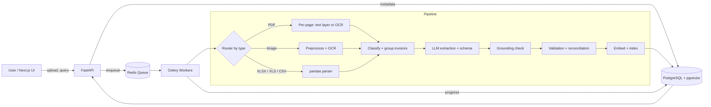

<div align="center">

# 📄 DocIntel

### AI-Powered Document Intelligence System

Turn invoices, receipts, scans and spreadsheets into validated, searchable, structured data.


[Quick Start](#-quick-start) · [Architecture](#-architecture) · [API](#-api-overview) · [Evaluation](#-evaluation-results) · [Design Decisions](#-design-decisions)

</div>

---

## 📖 Overview

A company receives thousands of financial documents daily (digital PDFs, scanned PDFs of up to ~1000 pages, images, Excel and CSV files). Staff manually extract invoice data, verify calculations, and cross-check documents against each other. This is slow and error-prone.

**DocIntel** automates that workflow:

1. **Ingests** PDF, JPG, PNG, TIFF, XLSX, XLS and CSV files.
2. **Extracts** text (native or OCR) and structured spreadsheet data.
3. **Understands** documents with an LLM, returning schema-validated JSON.
4. **Validates** numbers, dates, duplicates and cross-document consistency.
5. **Flags** anything uncertain for human review. It never invents values.
6. **Serves** results through a REST API and a web UI with keyword and semantic search.

---

## ✨ Features

| Area | Capabilities |
|---|---|
| **Processing** | Digital PDF text extraction, OCR for scans and images, multi-sheet Excel, CSV, multi-page and ~1000-page PDFs, corrupted-file handling |
| **Extraction** | Invoice number, date, supplier, customer, subtotal, tax, total, currency, line items, with per-field confidence and source evidence |
| **Validation** | Missing fields, numeric consistency, duplicates, date and currency checks, PDF-PDF and PDF-Excel reconciliation |
| **Backend** | Async background jobs, live progress, retries, reprocessing of failed jobs, manual corrections with audit trail |
| **Search** | Keyword filters plus semantic search (pgvector) |
| **Frontend** | Multi-file upload, progress monitoring, extraction inspector, error review, inline correction, search |
| **Reliability** | Idempotent jobs, retries, graceful failure on corrupted files |

---

## 🏗 Architecture



> A full diagram and schema live in [`docs/architecture.md`](docs/architecture.md) and [`docs/database_schema.md`](docs/database_schema.md).

### Processing a ~1000-page PDF

- The file is split into **per-page tasks** that run in parallel across workers, so the file is never loaded whole into memory.
- Each page uses its **text layer if present**, otherwise OCR.
- Pages are grouped into invoices by boundary detection, and **LLM calls are made per invoice, not per page**.
- Progress is streamed to the UI (for example, `412 / 1000 pages`).

### How hallucination is controlled

- Missing or uncertain fields are returned as `null`, never guessed.
- Every field carries `confidence` and a `source_snippet`.
- A **grounding check** verifies each extracted value appears in the source text. Ungrounded values are nulled or flagged.
- Output is validated against a strict Pydantic schema. Money uses `Decimal`, never floats.

---

## 🧰 Tech Stack

| Layer | Technology | Why |
|---|---|---|
| API | FastAPI (Python) | Single language across OCR, pandas and LLM libraries |
| Queue | Redis + Celery | Per-page tasks, retries, progress tracking |
| Database | PostgreSQL + pgvector | Relational data, JSONB, and vector search in one store |
| PDF text | PyMuPDF | Fast text-layer detection and extraction |
| OCR | Tesseract / PaddleOCR + OpenCV | Deskew, denoise, binarize for poor scans |
| Spreadsheets | pandas, openpyxl, xlrd | Multi-sheet parsing and header detection |
| LLM | _TBD: provider and model_ | Structured output / JSON schema |
| Frontend | Next.js + Tailwind CSS | Upload, review, correct, search |
| Infra | Docker Compose | One-command setup |

See [Design Decisions](#-design-decisions) for trade-offs.

---

## 🚀 Quick Start

### Prerequisites

- Docker and Docker Compose
- An LLM API key (see [Configuration](#-configuration))

### Run with Docker (recommended)

```bash
git clone <repo-url>
cd <repo-name>

cp .env.example .env        # then fill in your values
docker compose up --build
```

| Service | URL |
|---|---|
| Web UI | http://localhost:3000 |
| API | http://localhost:8000 |
| API docs (Swagger) | http://localhost:8000/docs |

Scale workers for large documents:

```bash
docker compose up --scale worker=4
```

### Local development (without containerizing the app)

```bash
docker compose up -d postgres redis      # infrastructure only

# Backend (uses uv; see backend/pyproject.toml)
cd backend
uv sync
cp ../.env.example ../.env               # fill in DATABASE_URL/REDIS_URL host values
uv run alembic upgrade head              # no-op until first migration exists
uv run uvicorn app.main:create_app --factory --reload
uv run celery -A app.workers.celery_app.celery_app worker --loglevel=info

# Frontend (scaffolded in a later milestone)
cd frontend
npm install
npm run dev
```

---

## ⚙️ Configuration

All settings are environment variables, validated at startup. Copy `.env.example` to `.env`.

| Variable | Description |
|---|---|
| `DATABASE_URL` | PostgreSQL connection string |
| `REDIS_URL` | Redis connection string |
| `LLM_API_KEY` | API key for the LLM provider |
| `LLM_MODEL` | Model name used for extraction |
| `MAX_UPLOAD_MB` | Maximum file size |
| `MAX_PDF_PAGES` | Maximum pages per PDF |
| `OCR_ENGINE` | `tesseract` or `paddle` |

> ⚠️ Never commit `.env`. Only `.env.example` (placeholders) is tracked.

---

## 🔌 API Overview

Interactive docs are available at `/docs`.

| Method | Endpoint | Description |
|---|---|---|
| `GET` | `/health` | Liveness probe (no dependencies) |
| `GET` | `/ready` | Readiness probe (database + Redis) |
| `POST` | `/api/v1/documents` | Upload one or more files (multipart) |
| `GET` | `/api/v1/documents` | List and filter (`q`, `status`, `supplier`, `date_from`, `date_to`) |
| `GET` | `/api/v1/documents/{id}/status` | Processing status and progress |
| `GET` | `/api/v1/documents/{id}/result` | Extracted JSON and validation issues |
| `PATCH` | `/api/v1/documents/{id}/fields` | Manual correction (re-runs validation) |
| `POST` | `/api/v1/documents/{id}/reprocess` | Reprocess a failed job |
| `POST` | `/api/v1/search/semantic` | Semantic search |
| `GET` | `/api/v1/reconciliations` | Cross-document verification results |

### Example extraction result

```json
{
  "document_id": "3f6c...",
  "status": "needs_review",
  "invoice": {
    "invoice_number": { "value": "INV-2041", "confidence": 0.97, "source": "Invoice No: INV-2041" },
    "invoice_date":   { "value": "2025-03-14", "confidence": 0.94, "source": "Date: 14/03/2025" },
    "supplier_name":  { "value": "Acme Supplies Ltd", "confidence": 0.91, "source": "Acme Supplies Ltd" },
    "customer_name":  { "value": null, "confidence": 0.0, "source": null },
    "subtotal":       { "value": "1000.00", "confidence": 0.98, "source": "Subtotal 1,000.00" },
    "tax":            { "value": "100.00", "confidence": 0.98, "source": "VAT 10% 100.00" },
    "total":          { "value": "1150.00", "confidence": 0.98, "source": "Total 1,150.00" },
    "currency":       { "value": "USD", "confidence": 0.99, "source": "USD" },
    "line_items": []
  },
  "issues": [
    { "code": "TOTAL_MISMATCH", "severity": "error", "message": "subtotal + tax (1100.00) != total (1150.00)" },
    { "code": "MISSING_FIELD", "severity": "warning", "message": "customer_name not found" }
  ]
}
```

_Illustrative example of the response shape, not real output._

---

## ✅ Validation Rules

| Rule | Description |
|---|---|
| **Required fields** | Flags missing invoice number, date, supplier, total, currency |
| **Totals** | `subtotal + tax = total` within a rounding tolerance |
| **Line items** | `Σ(qty × unit price) = subtotal` |
| **Tax plausibility** | Tax rate within an expected range |
| **Dates** | Valid, not impossible, not implausibly future |
| **Currency** | Valid ISO 4217 code, consistent across the document |
| **Duplicates** | Same file hash, or same supplier + invoice number + total |
| **Confidence** | Low OCR or extraction confidence routes to review |
| **Cross-verification** | PDF vs PDF and PDF vs Excel (ledger/PO) by invoice number: totals and line items |

Documents end in one of three states: `ok`, `needs_review`, or `failed`.

---

## 🗄 Database

Core tables: `documents`, `pages`, `extractions`, `line_items`, `validation_issues`, `corrections` (audit trail), `processing_events` (history), `embeddings` (pgvector), `reconciliations`.

Full schema and ER diagram: [`docs/database_schema.md`](docs/database_schema.md).

---

## 🔒 Security

- File type verified by **content (magic bytes)**, not extension
- Size and page limits, filename sanitization
- Rate limiting on uploads
- Parameterized queries via ORM only
- OCR text and LLM output treated as **untrusted input** (schema validation, prompt-injection awareness)
- Secrets only via environment variables
- No PII or document contents in logs

> **Privacy note:** document text is sent to an external LLM API for extraction. For sensitive data, use a provider with a zero-retention agreement or a self-hosted model.

---

## 📈 Scalability and Reliability

- Heavy work (OCR, LLM, embeddings) runs in background workers, never in the request path
- Page-parallel processing; workers scale horizontally
- Idempotent jobs with retries, backoff and a dead-letter path
- Paginated endpoints and indexed filter columns
- Explicit timeouts on all external calls

---

## 🧪 Testing

```bash
cd backend
pytest -v --cov=app
```

Covers: PDF processing, OCR, spreadsheet parsing, AI extraction (mocked LLM), validation rules, API endpoints, and failure scenarios (corrupted files, empty files, malformed LLM output, timeouts).

---

## 📊 Evaluation Results

Evaluated on a labeled dataset of synthetic and degraded invoices, plus deliberately bad cases (corrupted files, wrong totals, duplicates).

```bash
python -m evaluation.run --dataset evaluation/dataset --report docs/evaluation_report.md
```

> ⚠️ **Status: not yet measured.** The values below are placeholders and will be replaced with actual numbers from the evaluation run. Full methodology: [`docs/evaluation_report.md`](docs/evaluation_report.md).

| Metric | Result |
|---|---|
| Dataset size | TBD |
| Extraction accuracy (field-level) | TBD |
| Processing time | TBD |
| Document success rate | TBD |
| Failure rate | TBD |

---

## 🧭 Design Decisions

| Decision | Rationale | Trade-off |
|---|---|---|
| Python for the whole backend | OCR, pandas and LLM libraries are Python-native; avoids cross-service glue | NestJS was suggested; a single-language stack is simpler for an AI-focused service |
| PostgreSQL + pgvector | One database for relational, JSONB and vector search | Dedicated vector DBs scale further at very large volumes |
| Celery + Redis | Mature retries, routing and concurrency | Heavier than lightweight queues |
| Per-page parallelism | Handles ~1000-page PDFs without memory blowup | More orchestration complexity |
| Grounding check | Prevents invented values | Can null valid values when OCR is poor |
| `Decimal` for money | Avoids float rounding errors | Requires care at JSON and DB boundaries |

---

## 📁 Project Structure

```
.
├── backend/
│   ├── app/
│   │   ├── api/            # route handlers
│   │   ├── core/           # config, security, logging
│   │   ├── models/         # ORM models
│   │   ├── schemas/        # Pydantic schemas
│   │   ├── services/       # business logic
│   │   ├── repositories/   # DB access
│   │   ├── pipelines/      # pdf, image, spreadsheet processing
│   │   ├── extraction/     # LLM prompts, schema, grounding
│   │   ├── validation/     # rules engine, reconciliation
│   │   └── workers/        # background tasks
│   ├── tests/
│   └── evaluation/         # dataset generator, metrics
├── frontend/               # Next.js app
├── docs/                   # architecture, schema, evaluation, AI disclosure, progress
├── docker-compose.yml
├── AGENTS.md
└── README.md
```

---

## ⚠️ Known Limitations

_To be completed honestly as the project progresses (for example: handwriting, unusual layouts, languages other than the tested set, LLM cost at scale)._

---

## 🎥 Walkthrough

Recorded demo of the working application: _TBD (link to be added)_

## 🤖 AI-Assisted Development

AI assistance and the prompts used are disclosed in [`docs/ai_disclosure.md`](docs/ai_disclosure.md).

## 📝 Project Progress

Current status and daily log: [`docs/PROGRESS.md`](docs/PROGRESS.md).

---

<div align="center">

Built for the Senior AI Engineer assignment · See [`AGENTS.md`](AGENTS.md) for engineering standards

</div>