# Architecture

Design specification for **DocIntel**, the AI-Powered Document Intelligence System.
Describes intended architecture; no application code exists yet, so nothing here is runtime-verified.
Full table definitions: [`database_schema.md`](database_schema.md).

## 1. Overview and requirements

Ingests digital and scanned PDFs (up to ~1000 pages), images, Excel and CSV files; extracts structured invoice data with an LLM; validates and cross-verifies documents; serves results through a REST API and a web UI.

| Requirement | Architectural response |
|---|---|
| ~1000-page PDFs | Per-page parallel Celery tasks; never load a file whole into memory |
| Low latency on the request path | All heavy work (OCR, LLM, embeddings) runs in background workers |
| Reliability | Idempotent jobs, retries with backoff, dead-letter path, recorded failures |
| No invented values | Grounding check against source text; `null` + confidence instead of guesses |
| Scalability | Stateless services; state in PostgreSQL/Redis; workers scale horizontally |
| Security | Magic-byte upload validation, JWT auth, parameterized ORM queries, untrusted LLM output |

## 2. System context

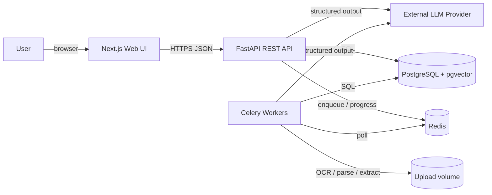

External dependencies: LLM provider API (over the network), PostgreSQL, Redis, filesystem (or object storage in production) for uploaded files.

## 3. Containers

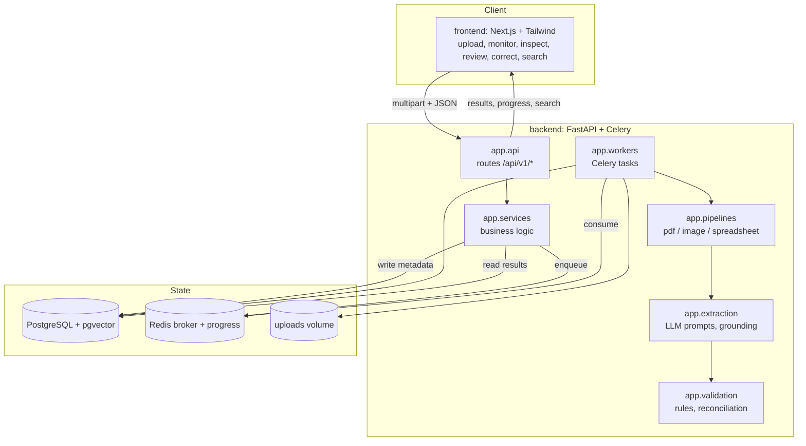

| Container | Role | Entry point |
|---|---|---|
| Next.js UI | Six capabilities only: upload, monitor, inspect, review, correct, search | `frontend/` |
| FastAPI API | Auth, upload, query, correction, search endpoints; no heavy work in-request | `backend/app/main.py` (planned) |
| Celery workers | Pipeline execution, retries, progress events | `backend/app/workers/` |
| PostgreSQL + pgvector | Source of truth + vectors for semantic search | — |
| Redis | Celery broker + progress/event channel | — |
| Upload volume | Stored original files, per-page artifacts | configured path |

## 4. Backend layering and module map

Strict layering; no route business logic, no services touching HTTP objects.

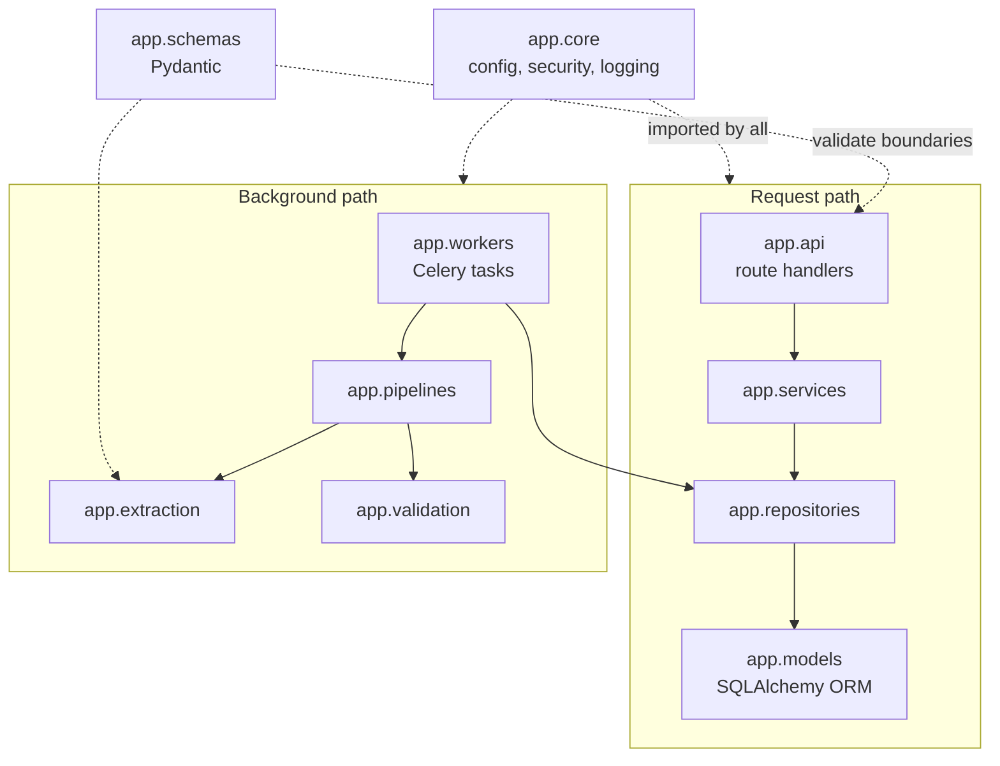

Rules:
- `api` → `services` → `repositories` → `models` only; never skip layers.
- Each pipeline stage (ingest, parse, OCR, extract, validate, index) is an independent module behind a clear interface.
- Swappable parts (OCR engine, LLM provider, vector store) hidden behind abstractions.
- Configuration only from `app.core.config` settings objects (env vars), never scattered constants.

## 5. Ingestion and routing

Uploads validated by **content (magic bytes)**, not extension. Size and page limits enforced before enqueue.

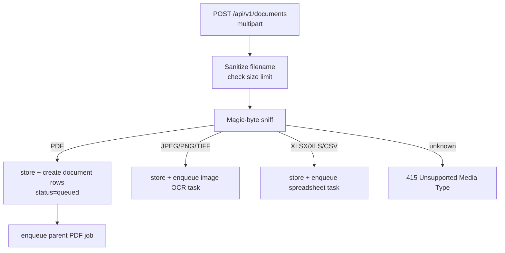

| Type | First stage |
|---|---|
| PDF | Open with PyMuPDF; detect page count vs `MAX_PDF_PAGES`; fan out per-page tasks (§6) |
| Image | OpenCV preprocess (deskew, denoise, binarize) → OCR engine |
| Spreadsheet | pandas + openpyxl/xlrd: multi-sheet parse, header detection → invoice records |

## 6. Large-PDF processing (per-page fan-out)

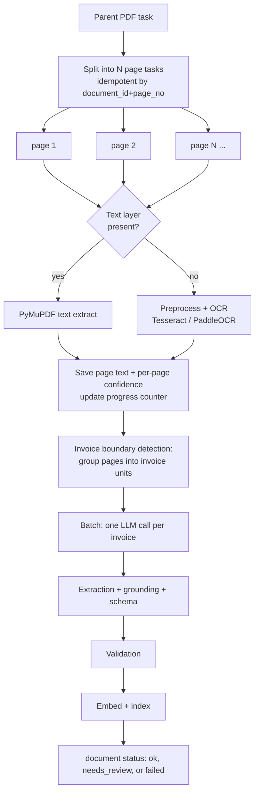

- Page tasks run in parallel across workers; a 1000-page file is 1000 small tasks, not one large job.
- Progress: atomic counter of completed pages stored in DB (`pages` rows + `processing_events`), surfaced as `412 / 1000`.
- LLM calls capped **per invoice**, not per page, to control cost and latency.
- Idempotency: re-running a page task overwrites the same `pages` row; safe on retry.

## 7. Extraction and grounding

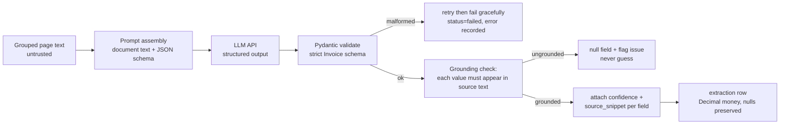

- Missing/uncertain fields are `null` with confidence `0`, never invented (AGENTS.md §2.4).
- Money parsed to `Decimal`; floats forbidden.
- LLM output treated as untrusted: schema-validated, prompt-injection aware (document text never interpreted as instructions).

## 8. Validation and reconciliation

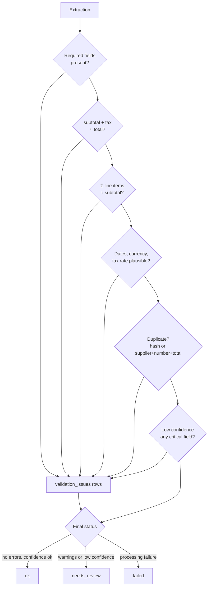

Cross-document reconciliation (runs when related documents share supplier + invoice number, or on demand):

| Pair | Check |
|---|---|
| PDF vs PDF | Totals and line items for same invoice number |
| PDF vs Excel | PDF totals/line items vs ledger or PO rows matched by invoice number |

Results stored in `reconciliations` with per-field match/mismatch evidence.

## 9. Job lifecycle and queues

Document-level state machine:

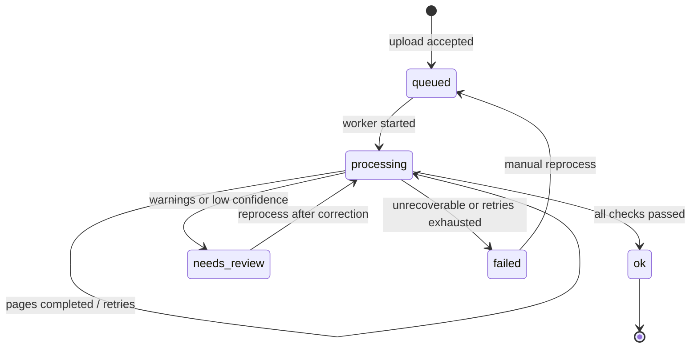

Task-level rules:
- Queues: `ingest` (light routing), `ocr` (CPU-heavy), `extract` (LLM-bound), `index` (embeddings) — isolated so OCR backlog cannot starve extraction.
- Retries: exponential backoff + jitter, **only for idempotent tasks**; LLM timeouts and 429s handled gracefully.
- Dead-letter: retries exhausted → failure recorded in `processing_events`, document `failed`, reprocessable via API.
- Graceful shutdown: in-flight tasks finish or are requeued; temp files cleaned.

## 10. Sequence: upload → enqueue → monitor progress

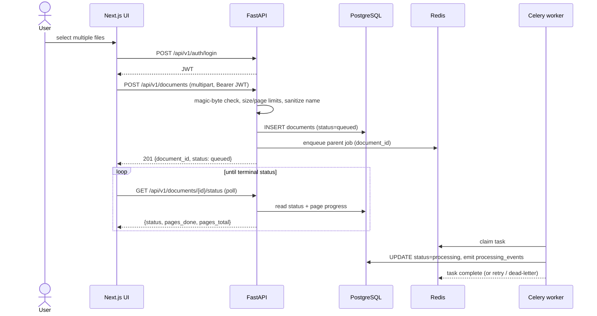

## 11. Sequence: PDF fan-out → extract → validate

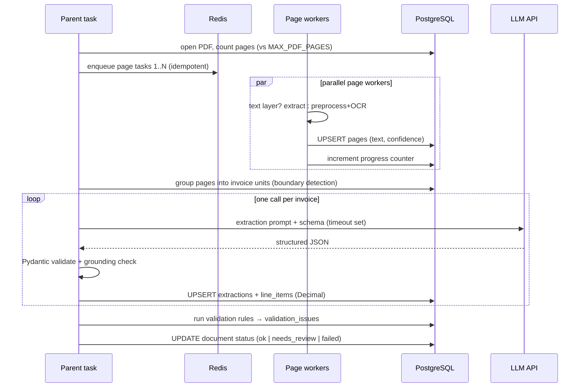

## 12. Sequence: cross-document reconciliation

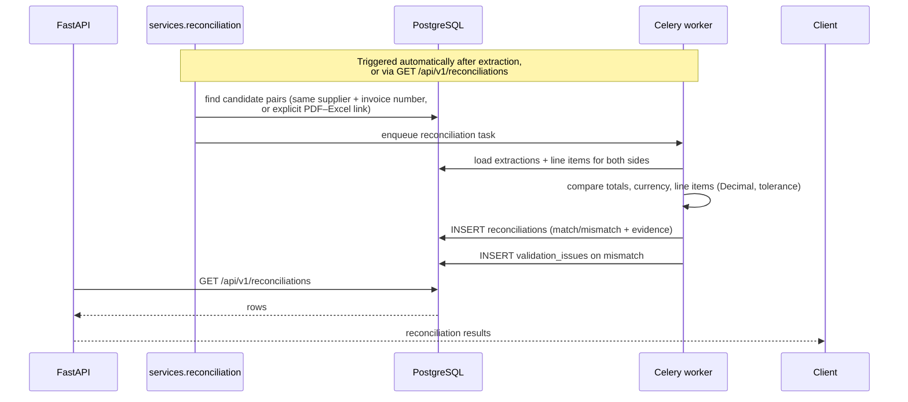

## 13. Sequence: manual correction → re-validate → audit

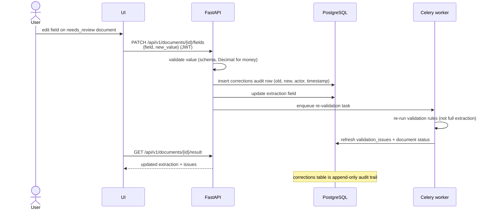

## 14. Sequence: authentication

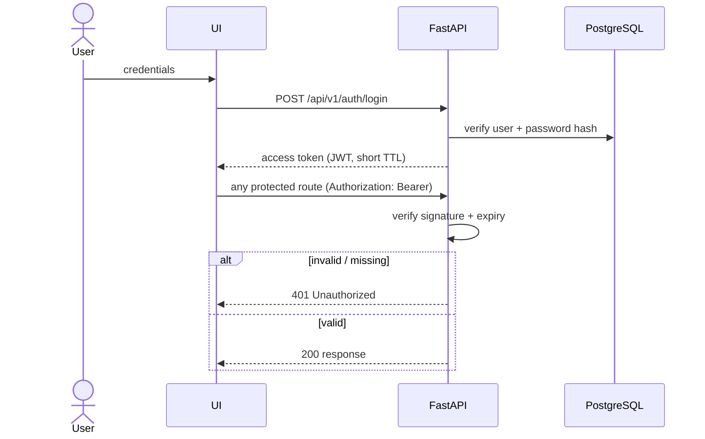

Every endpoint authenticated and authorized; rate limit applied on upload routes.

## 15. Sequence: reprocess failed job

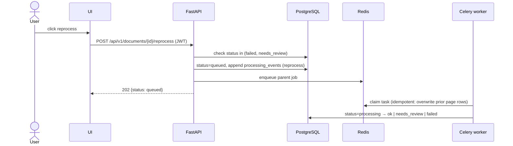

## 16. Sequence: keyword and semantic search

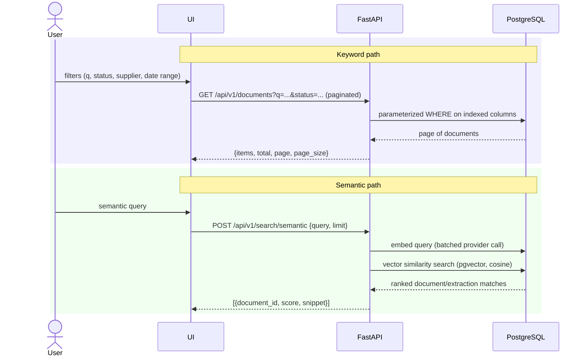

## 17. Sequence: failure paths (corrupted file, LLM timeout, malformed output)

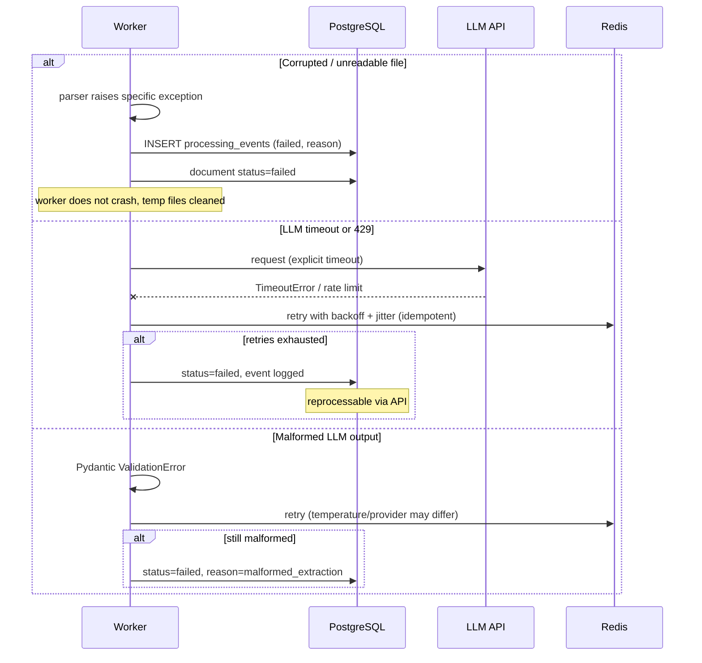

## 18. Search architecture

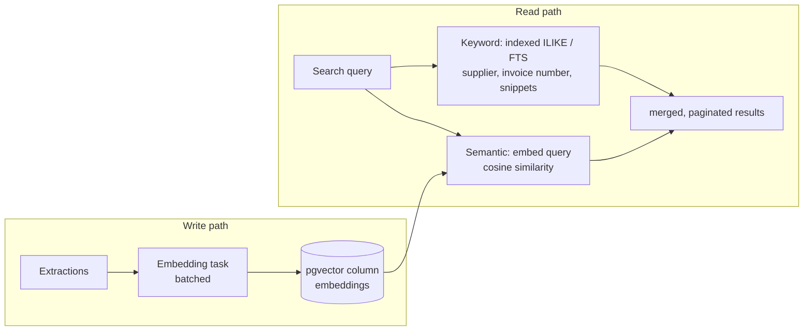

- Keyword filters hit DB indexes only; no scan of unindexed text columns.
- Embeddings built in background after extraction; never in the request path.
- All list endpoints paginated.

## 19. Security architecture

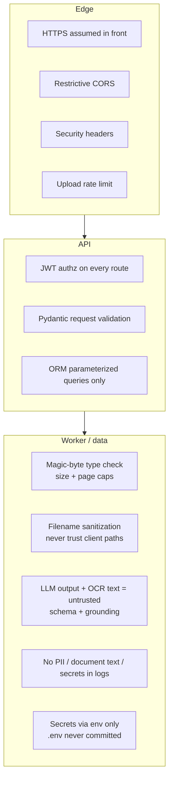

Privacy: document text is sent to an external LLM API — flagged in README; zero-retention or self-hosted model for sensitive data.

## 20. Deployment topology

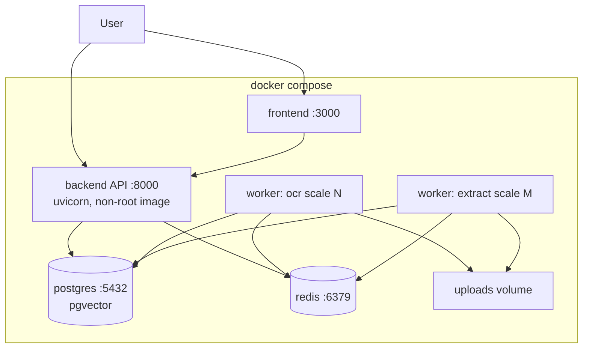

- `docker compose up` works from a clean clone; dependency versions pinned.
- Config: env vars validated at startup (fail fast); `.env.example` tracked, `.env` never.
- Health: `/health` (liveness), `/ready` (DB, Redis, queue reachable); basic metrics (queue depth, job duration, failure rate).
- DB schema changes only via versioned, reversible Alembic migrations.

## 21. Scalability notes

| Concern | Response |
|---|---|
| CPU-bound OCR | Dedicated `ocr` queue; horizontal worker replicas |
| LLM rate limits / cost | Per-invoice calls, batching, cache identical documents by hash, token/cost tracking per document |
| Memory | Page-level tasks; streaming PDF open; no full-file loads |
| DB growth | Indexes on every filtered column; paginated lists; avoid N+1 via repositories |
| Hot document updates | Progress writes batched/atomic; single-writer per document parent task |

## 22. Decision and trade-off table

| Decision | Rationale | Trade-off |
|---|---|---|
| Python for backend | OCR, pandas, LLM libs are Python-native | Single language beats suggested NestJS split for this scope |
| PostgreSQL + pgvector | Relational + JSONB + vectors in one store | Dedicated vector DB scales further at extreme volume |
| Celery + Redis | Mature retries, routing, concurrency control | Heavier than minimal queues |
| Per-page parallelism | ~1000-page PDFs without memory blowup | Orchestration complexity |
| Grounding check | Blocks invented values | Can null valid values when OCR is poor |
| `Decimal` / `NUMERIC` for money | No float rounding errors | Care required at JSON/DB boundaries |
| LLM per invoice, not per page | Cost and latency control | Invoice boundary detection must be reliable |

## Related documents

- [`database_schema.md`](database_schema.md) — full tables, columns, indexes, ER diagram
- [`../README.md`](../README.md) — overview, API table, quick start
- [`PROGRESS.md`](PROGRESS.md) — status board and daily log
- [`ai_disclosure.md`](ai_disclosure.md) — AI-assisted development record
