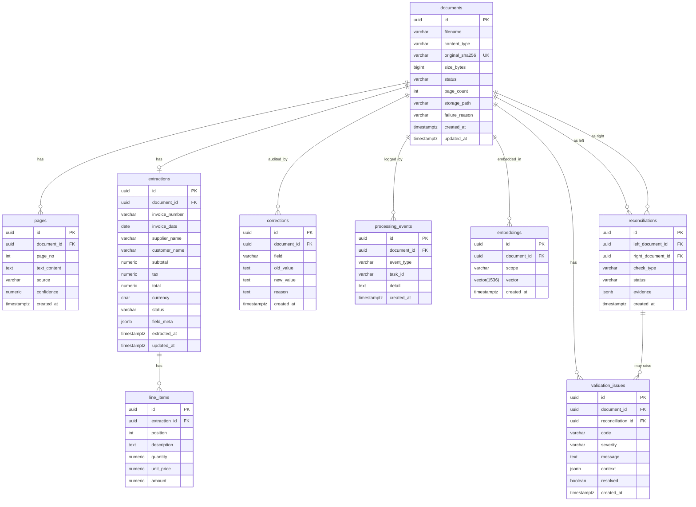

# Database Schema

Full PostgreSQL schema for DocIntel. Money is always `NUMERIC` (never `float`); primary keys are `uuid`; timestamps are `timestamptz`.
Schema changes only via versioned, reversible Alembic migrations — never edit by hand.
High-level context: [`architecture.md`](architecture.md).

## ER diagram



## Tables

### `documents`

One row per uploaded file; parent of all processing state.

| Column | Type | Notes |
|---|---|---|
| `id` | `uuid` PK | |
| `filename` | `varchar(512)` | sanitized display name, not a path |
| `content_type` | `varchar(128)` | detected from magic bytes, not client header |
| `original_sha256` | `char(64)` UK | idempotent re-upload / duplicate detection |
| `size_bytes` | `bigint` | not null; checked vs `MAX_UPLOAD_MB` |
| `status` | `varchar(32)` | `queued` \| `processing` \| `ok` \| `needs_review` \| `failed` |
| `page_count` | `int` | PDFs; enforced vs `MAX_PDF_PAGES` |
| `storage_path` | `varchar(1024)` | server-side path under configured volume; never client-supplied |
| `failure_reason` | `text` | null unless `failed`; safe for UI (no stack traces) |
| `created_at` / `updated_at` | `timestamptz` | |

Indexes: `status`, `created_at` (list filters, pagination), `original_sha256` (unique).

### `pages`

Per-page OCR/text result; also the progress counter (count of rows with `text_content` vs `page_count`).

| Column | Type | Notes |
|---|---|---|
| `id` | `uuid` PK | |
| `document_id` | `uuid` FK → `documents.id` | not null, `ON DELETE CASCADE` |
| `page_no` | `int` | not null; unique per document |
| `text_content` | `text` | null until processed |
| `source` | `varchar(16)` | `text_layer` \| `ocr` \| null |
| `confidence` | `numeric(5,4)` | OCR confidence 0–1; null for text layer |
| `created_at` | `timestamptz` | |

Indexes: unique `(document_id, page_no)`; `(document_id)`.

### `extractions`

Exactly one current extraction per document (upsert by `document_id`). Per-field confidence and evidence live in `field_meta`.

| Column | Type | Notes |
|---|---|---|
| `id` | `uuid` PK | |
| `document_id` | `uuid` UK FK → `documents.id` | one extraction per document |
| `invoice_number` | `varchar(128)` | null if not found |
| `invoice_date` | `date` | null if not found |
| `supplier_name` | `varchar(512)` | null if not found |
| `customer_name` | `varchar(512)` | null if not found |
| `subtotal` | `numeric(18,4)` | **NUMERIC, never float**; null if not found |
| `tax` | `numeric(18,4)` | |
| `total` | `numeric(18,4)` | |
| `currency` | `char(3)` | ISO 4217 |
| `status` | `varchar(32)` | denormalized copy of document review status |
| `field_meta` | `jsonb` | per-field `{confidence, source_snippet, issues}` — never null-guessed |
| `extracted_at` / `updated_at` | `timestamptz` | |

Indexes: `invoice_number`, `supplier_name`, `invoice_date` (search filters, reconciliation joins).

`field_meta` shape (one key per field):

```json
{
  "total": {
    "confidence": 0.98,
    "source_snippet": "Total 1,150.00",
    "grounded": true
  },
  "customer_name": {
    "confidence": 0.0,
    "source_snippet": null,
    "grounded": false
  }
}
```

### `line_items`

| Column | Type | Notes |
|---|---|---|
| `id` | `uuid` PK | |
| `extraction_id` | `uuid` FK → `extractions.id` | not null, cascade |
| `position` | `int` | not null; order on document |
| `description` | `text` | |
| `quantity` | `numeric(18,4)` | |
| `unit_price` | `numeric(18,4)` | |
| `amount` | `numeric(18,4)` | |

Indexes: `(extraction_id, position)`.

### `validation_issues`

| Column | Type | Notes |
|---|---|---|
| `id` | `uuid` PK | |
| `document_id` | `uuid` FK → `documents.id` | not null |
| `reconciliation_id` | `uuid` FK → `reconciliations.id` | null unless raised by cross-check |
| `code` | `varchar(64)` | e.g. `TOTAL_MISMATCH`, `MISSING_FIELD`, `DUPLICATE`, `CROSS_DOC_MISMATCH` |
| `severity` | `varchar(16)` | `error` \| `warning` \| `info` |
| `message` | `text` | human-readable; no stack traces |
| `context` | `jsonb` | e.g. `{"expected": "1100.00", "actual": "1150.00"}` |
| `resolved` | `boolean` | default false; set true after correction re-validation |
| `created_at` | `timestamptz` | |

Indexes: `(document_id)`, `(code)`, partial `(document_id) where not resolved`.

### `corrections`

Append-only audit trail for manual edits. Never update or delete rows.

| Column | Type | Notes |
|---|---|---|
| `id` | `uuid` PK | |
| `document_id` | `uuid` FK → `documents.id` | not null |
| `field` | `varchar(64)` | extraction field name |
| `old_value` | `text` | prior value (string form; null preserved as empty + flag) |
| `new_value` | `text` | corrected value |
| `reason` | `text` | optional |
| `created_at` | `timestamptz` | |

Indexes: `(document_id, created_at)`.

### `processing_events`

Job lifecycle log (queued, started, page_done, retried, failed, reprocess, done). No PII, no document text.

| Column | Type | Notes |
|---|---|---|
| `id` | `uuid` PK | |
| `document_id` | `uuid` FK → `documents.id` | not null |
| `event_type` | `varchar(32)` | not null |
| `task_id` | `varchar(128)` | Celery task id, for correlation |
| `detail` | `text` | short, sanitized |
| `created_at` | `timestamptz` | |

Indexes: `(document_id, created_at)`.

### `embeddings`

pgvector store for semantic search. One row per embedding scope.

| Column | Type | Notes |
|---|---|---|
| `id` | `uuid` PK | |
| `document_id` | `uuid` FK → `documents.id` | not null |
| `scope` | `varchar(32)` | `extraction` \| `page_text` \| `query_log` |
| `vector` | `vector(1536)` | dimension must match embedding model; configurable at migration time |
| `created_at` | `timestamptz` | |

Indexes: HNSW or IVFFlat on `vector` (cosine distance); `(document_id, scope)`.
Note: pgvector extension required (`CREATE EXTENSION IF NOT EXISTS vector`).

### `reconciliations`

Cross-document verification (PDF–PDF, PDF–Excel).

| Column | Type | Notes |
|---|---|---|
| `id` | `uuid` PK | |
| `left_document_id` | `uuid` FK → `documents.id` | not null |
| `right_document_id` | `uuid` FK → `documents.id` | not null; ≠ left |
| `check_type` | `varchar(32)` | `pdf_pdf` \| `pdf_excel` |
| `status` | `varchar(32)` | `match` \| `mismatch` \| `incomplete` |
| `evidence` | `jsonb` | per-field comparison: values, deltas, matched line items |
| `created_at` | `timestamptz` | |

Indexes: `(left_document_id)`, `(right_document_id)`, unique `(left_document_id, right_document_id, check_type)`.

## Index strategy (summary)

Every column used in list filters, joins, or search has an index (AGENTS.md §6.1): `documents.status`, `documents.created_at`, `extractions.invoice_number`, `extractions.supplier_name`, `extractions.invoice_date`, `pages(document_id, page_no)` unique, `embeddings.vector` (HNSW), plus FKs used in cascade/joins. Lists always paginate (`LIMIT/OFFSET` or keyset on `created_at`).

## Money rules

- DB: `NUMERIC(18,4)` only. No `float`/`double precision` for money, anywhere.
- App: Python `Decimal` end to end; JSON responses emit strings (e.g. `"1150.00"`), never binary floats.
- Comparisons use explicit rounding tolerance, documented in the validation rule that applies them.

## Migration rules (Alembic)

- One migration per logical change; reversible (`upgrade` + `downgrade`).
- Safe on existing data: expand → migrate → contract for breaking column changes.
- pgvector dimension changes require a rebuild migration; pin model dimension in config before first prod migration.
- Never edit an applied migration; write a new one.
- Multi-step writes in application code use transactions; failures roll back cleanly.

## Related documents

- [`architecture.md`](architecture.md) — pipelines, sequences, job lifecycle
- [`../README.md`](../README.md) — API surface and quick start
- [`PROGRESS.md`](PROGRESS.md) — status tracking
